## Study objective and approach

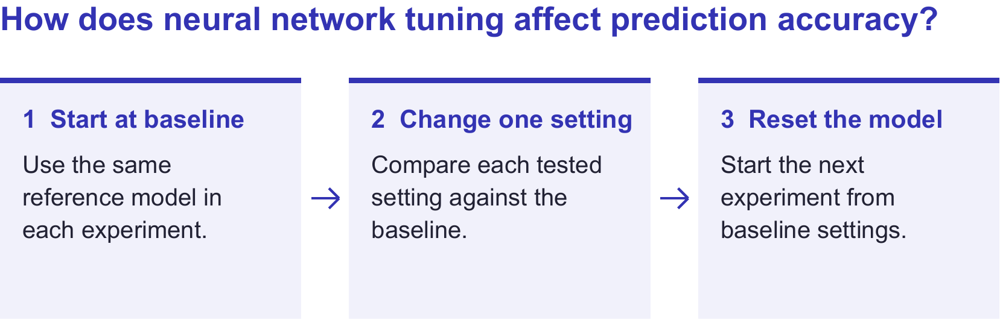{width=100% fig-alt="Study workflow. Start from baseline, change one setting and compare against baseline, then reset for the next experiment."}

## Data and preprocessing

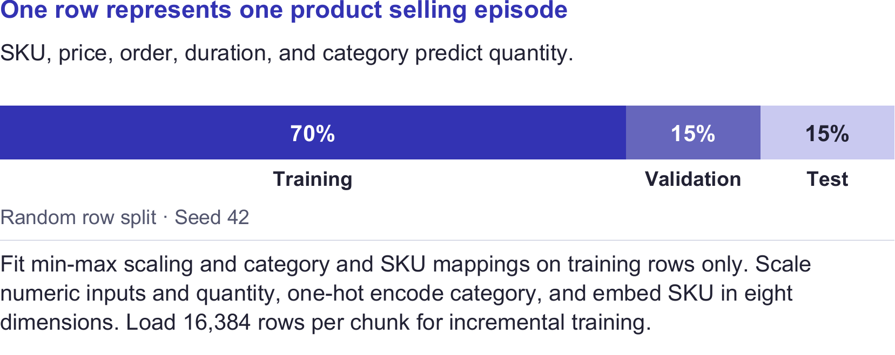{width=100% fig-alt="Product episode data and preprocessing. Random row split at seed 42 gives 70% training, 15% validation, and 15% test. Fit mappings and scaling on training rows only. Embed SKU in eight dimensions and load 16,384 rows per chunk."}

Repeated SKUs can occur across splits. The comparison concerns held-out episodes, including episodes for products seen in training.

## Training and evaluation

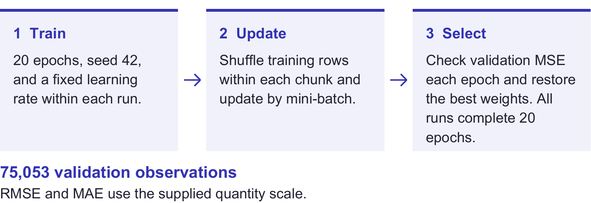{width=100% fig-alt="Train for 20 epochs with seed 42 and a fixed learning rate. Shuffle within each chunk and update by mini-batch. Evaluate validation MSE each epoch and restore the best weights. Report on 75,053 validation observations."}

**Source:** We tested 31 configurations on both October 30 and 31. Scores match across dates. Charts use the October 31 runs, including runtime.

These repeated runs use the same seed and do not measure variability across seeds. The CSV contains validation results only.

## Baseline model

Three sigmoid hidden layers: **21 / 12 / 7 neurons**. Eight-dimensional SKU embedding, one-hot category, scaled numeric inputs, and a linear output.

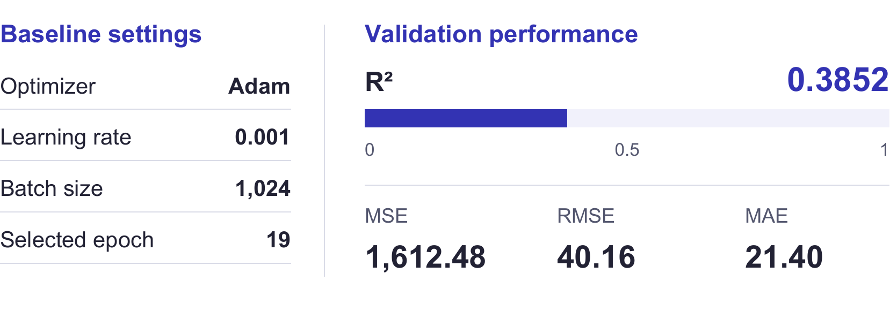{width=100% fig-alt="Baseline settings and validation metrics. Adam, learning rate 0.001, batch size 1,024, selected epoch 19. R-squared 0.3852, MSE 1,612.48, RMSE 40.16, MAE 21.40."}

All following $\Delta R^2$ values compare with this baseline. Positive values indicate improvement.

## Batch size

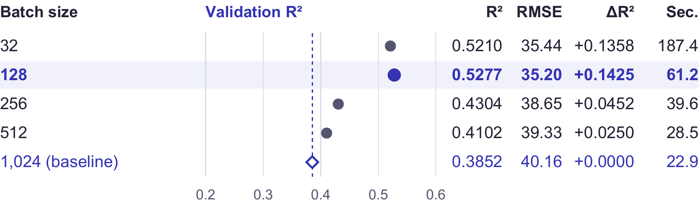{width=100% fig-alt="Validation R-squared by batch size with RMSE, change from baseline, and runtime. Batch 128 scored highest at 0.5277 and took 61.2 seconds."}

**Finding:** Batch 128 has the highest validation $R^2$ in this comparison, but takes about 2.7 times the baseline runtime.

**Interpretation:** Smaller batches make more weight updates per epoch. This comparison includes that extra optimization work. Runtime covers preprocessing and the training loop, including validation.

## Number of hidden layers

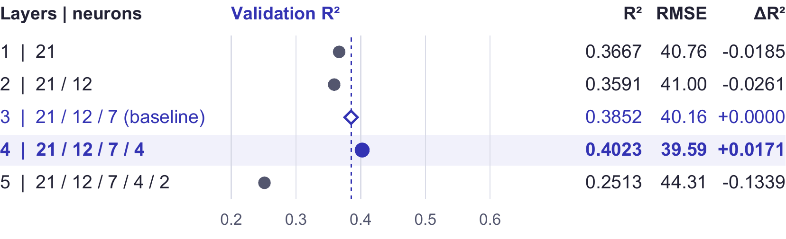{width=100% fig-alt="Validation R-squared by hidden-layer count with RMSE and change from baseline. Four layers scored highest at 0.4023."}

**Finding:** Four layers improve $R^2$ slightly. Five layers perform substantially worse.

**Interpretation:** Extra depth does not guarantee better predictions. The narrow added layers also change capacity, so this result applies to these specific architectures.

## Neurons per hidden layer

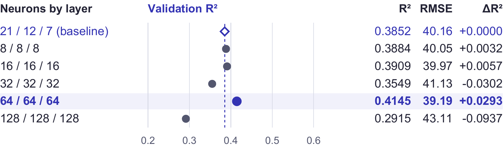{width=100% fig-alt="Validation R-squared by three-layer architecture with RMSE and change from baseline. The 64 / 64 / 64 network scored highest at 0.4145."}

**Finding:** The 64 / 64 / 64 network performs best among the tested widths. The widest network performs worse than the baseline.

**Interpretation:** More neurons change capacity and optimization. Scores do not improve steadily with width. These trials also replace the baseline's taper with equal-width layers.

## Hidden activation function

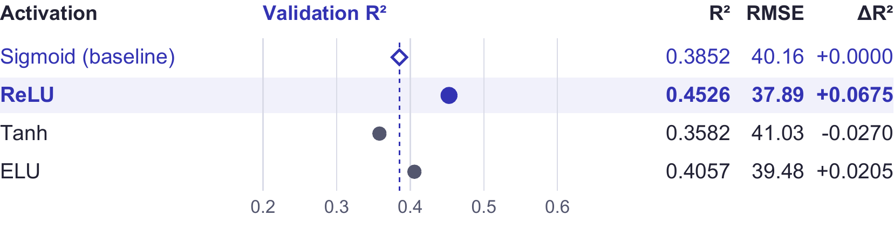{width=100% fig-alt="Validation R-squared by activation with RMSE and change from baseline. ReLU scores highest at 0.4526."}

**Finding:** ReLU gives the largest gain in this comparison. Tanh reduces $R^2$.

**Interpretation:** ReLU avoids sigmoid's positive-side saturation, which can help gradient flow. This is a possible explanation for the gain, not a measured gradient result.

The output layer remains linear for quantity regression.

## Optimizer

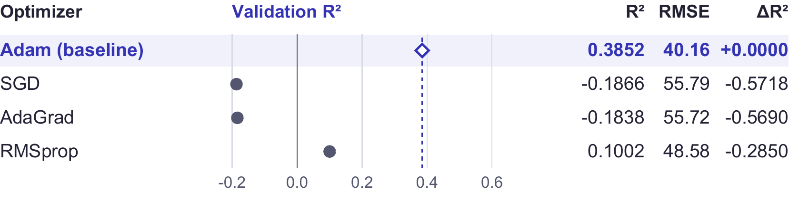{width=100% fig-alt="Validation R-squared by optimizer with RMSE and change from baseline. Adam scores highest at 0.3852. SGD and AdaGrad have negative scores."}

**Finding:** Adam performs best with the shared learning rate of **0.001**. SGD and AdaGrad have negative validation $R^2$.

Negative $R^2$ means greater squared error than predicting the validation-set mean.

**Interpretation:** Optimizers behave differently at the same learning rate. These runs compare a shared setting rather than each optimizer's best possible tuning.

## Learning rate

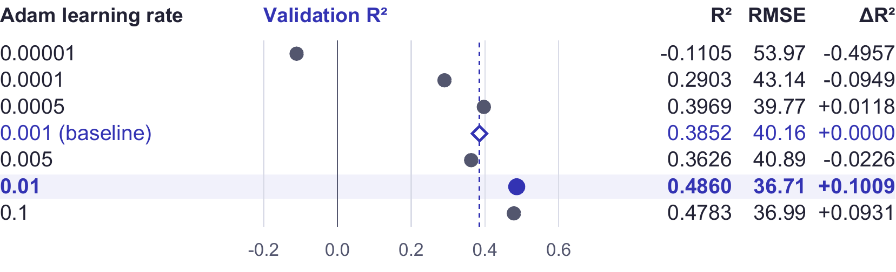{width=100% fig-alt="Validation R-squared by Adam learning rate with RMSE and change from baseline. The 0.01 rate scores highest at 0.4860."}

**Finding:** 0.01 performs best among these rates. The smallest rate produces negative $R^2$.

**Interpretation:** A very small rate may learn too slowly within the shared training budget. Larger rates help here, but the relationship is not monotonic.

## Sensitivity findings

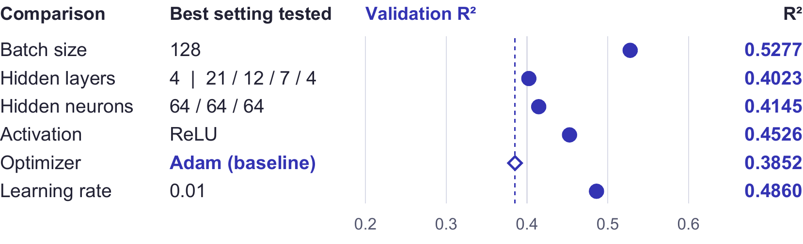{width=100% fig-alt="Highest observed validation R-squared in each independent comparison. Batch size 128 has the highest observed score at 0.5277."}

Learning rate and optimizer produce the largest observed spreads in $R^2$ across their tested settings.

Each row summarizes a separate comparison against baseline $R^2$ **0.3852**. These settings were not combined or confirmed as a final model.

## Scope and limitations

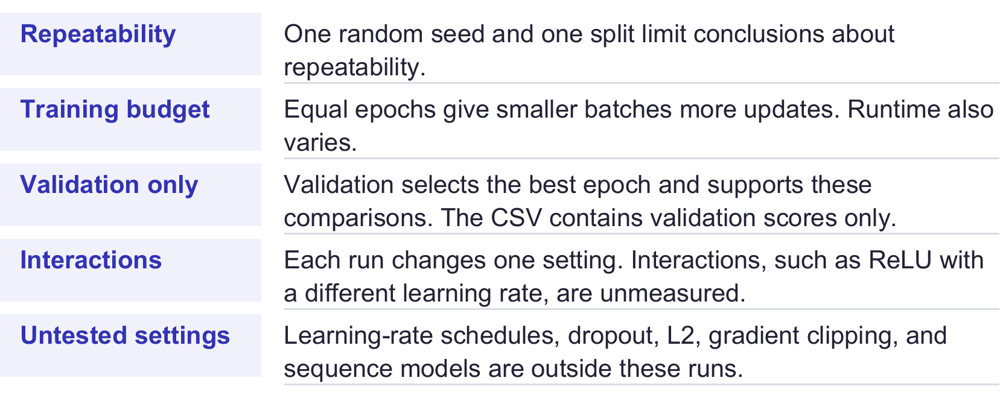{width=100% fig-alt="Study limitations include one seed and split, unequal update counts across batch sizes, validation-only scores, unmeasured interactions, and settings outside the tested runs."}

**Conclusion:** Performance is sensitive to tuning choices. More layers, more neurons, or a smaller learning rate do not consistently improve validation results.

## Team contributions

```{=latex}
\begin{center}
\begin{tabular}{@{}ll@{}}
\toprule
Team member & Team Contributions \\
\midrule
Ian Allish & \textbf{1–4:} Objective and approach, data, training \\
Joseph Falcone & \textbf{5–8:} Baseline, batch size, layer count, neuron count \\
Will Schneider & \textbf{9–11:} Activations, optimizers, learning rates \\
Noah Hoogerheide & \textbf{12–14:} Findings, limitations, team roles \\
\bottomrule
\end{tabular}
\end{center}
```

**AI assistance:** Codex helped revise this presentation.
